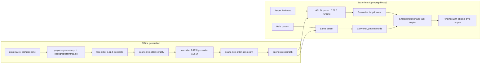
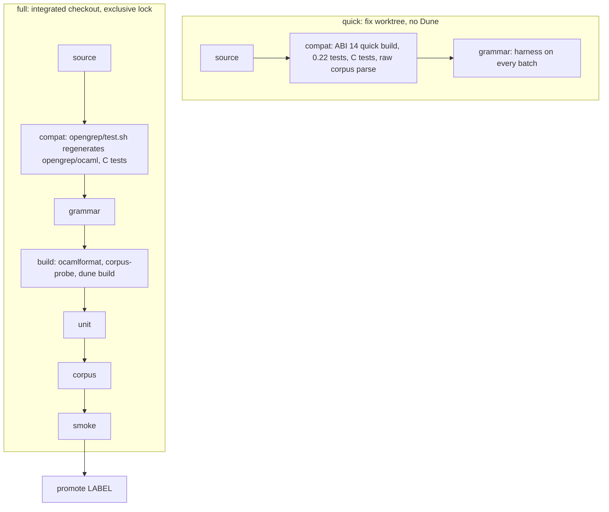

# Opengrep PowerShell support: architecture

How Opengrep's PowerShell support is built and how `ai-docs/` verifies it. It
describes structure, not progress: no current hashes or counts. How we make and
integrate changes is in [WORKFLOW.md](WORKFLOW.md); setup is in
[README.md](README.md).

Paths are relative to this grammar repository unless they say "Opengrep", in
which case they are relative to the Opengrep root. Links into Opengrep assume
this repository is checked out as Opengrep's submodule at
`languages/powershell/tree-sitter/opengrep-powershell`.

- New to the work: read [Overview](#1-overview), then [WORKFLOW.md](WORKFLOW.md).
- Changing the converter, grammar or generated parser: the matching part of
  [Components](#2-components).
- Running or reading validation output: [Validation](#3-validation).

## 1. Overview

Opengrep scans PowerShell (`.ps1`, `.psm1`, `.psd1`; language keys `powershell`
and `pwsh`) with its normal CLI, rule format and matching engine. There is no
separate PowerShell scanner and no PowerShell interpreter at scan time.

Three pieces make this work:

1. **A tree-sitter grammar** in this repository. The root `grammar.js` and
   `src/scanner.c` describe real PowerShell. A small Opengrep extension
   (`opengrep/grammar.cjs`) adds rule-only syntax such as `$...ARGS`.
2. **A generated OCaml parser library** (`opengrep/ocaml/lib/`): C parser
   tables, the external scanner, and OCaml types (`CST.ml`) and readers
   (`Parse.ml`) for the concrete syntax tree. It is generated offline and checked
   in, so normal Opengrep builds need neither Node.js nor the tree-sitter CLI.
3. **A converter** in Opengrep
   ([Parse_powershell_tree_sitter.ml](../../../generic/Parse_powershell_tree_sitter.ml))
   that maps the typed CST to Opengrep's generic AST, once for target files and
   once for rule patterns.

At scan time a file's raw bytes go to the tree-sitter 0.22.6 runtime with the
ABI 14 parser, the CST is converted to the generic AST, and the shared engine
matches it against patterns produced by the same parser and converter.



Verification runs alongside: `tools/validate.mjs` (quick for fix worktrees,
full for certification) and `tools/proof-kit.mjs` (fact-by-fact comparison with
PowerShell's own parser). Both always test the parser Opengrep runs.

The root `src/parser.c`, `src/grammar.json` and `src/node-types.json` are
generated by tree-sitter 0.25 for upstream use; Opengrep does not use them, and
the `ai-docs` tools do not test them.

## 2. Components

### 2.1 Language registration in Opengrep

| Concern | Opengrep file | What it does |
| --- | --- | --- |
| Language record | [lang.json](../../../../../interfaces/semgrep_interfaces/lang.json) | `id: powershell`, keys `powershell`/`pwsh`, extensions, shebangs `pwsh`/`powershell`. `Language.ml` is generated from it. |
| Language type | [Lang.ml](../../../../../src/rule/Lang.ml) | Constructor `Powershell`; `has_caseless_identifiers` is true for it. |
| File types | [File_type.ml](../../../../../libs/commons/File_type.ml) | `ps1`, `psm1`, `psd1` map to `PL (Script "powershell")`. |
| Target selection | [Guess_lang.ml](../../../../../src/targeting/Guess_lang.ml) | Accepts PowerShell files by language or lowercase extension (`foo.PsM1`). Tests in `Unit_guess_lang.ml`. |
| Target parsing | [Parse_target2.ml](../../../../../src/parsing_languages/Parse_target2.ml) | `Lang.Powershell` runs `Parse_powershell_tree_sitter.parse`. |
| Pattern parsing | [Parse_pattern2.ml](../../../../../src/parsing_languages/Parse_pattern2.ml) | `Parse_powershell_tree_sitter.parse_pattern`. |
| Pattern check | [Check_pattern.ml](../../../../../src/parsing/Check_pattern.ml) | `$x` in a pattern is not rejected as a bad metavariable. |
| Case-insensitive matching | `src/matching/Generic_vs_generic.ml`, `src/optimizing/` | Use `Lang.has_caseless_identifiers`; the converter also marks identifiers case-insensitive. |
| Unit suite | [Test.ml](../../../../../src/tests/Test.ml) | Registers `Unit_powershell.tests` with the `lang.powershell` tags. |

Everything else lives in Opengrep's `languages/powershell/`.

### 2.2 From file bytes to tree-sitter

1. `Parse_powershell_tree_sitter.parse` calls the generated
   `Tree_sitter_powershell.Parse.file` inside `H.wrap_parser`.
2. That reaches the shared
   [Tree_sitter_parsing.ml](../../../../../libs/ocaml-tree-sitter-core/src/run/lib/Tree_sitter_parsing.ml),
   which reads the file as raw bytes (no decoding, no BOM removal).
3. The shared C stub in
   [bindings.c](../../../../../libs/ocaml-tree-sitter-core/src/bindings/lib/bindings.c)
   calls `ts_parser_parse_string(parser, NULL, source, strlen(source))`.

Consequences the tools rely on:

- **Offsets are UTF-8 byte offsets of the original file.** A UTF-8 BOM reaches
  tree-sitter; the grammar's `extras` accept U+FEFF and offsets count the BOM.
- **`strlen` stops at the first NUL**, so UTF-16 input parses only a prefix and
  can report false success. Encoding support is deferred. `corpus-probe.c` and
  `ts-dump.c` pass the full length, so they do not share this problem.
- **Rows and columns are LF-based.** The converter maps tree-sitter positions
  back to byte offsets with line starts taken from `\n` only and slices the
  original bytes for token text.
- [`H.wrap_parser`](../../../../../libs/lib_parsing_tree_sitter/Parse_tree_sitter_helpers.ml)
  converts a CST even when tree-sitter reported errors; the CLI then reports a
  partial parse.

### 2.3 The generated OCaml parser library

`opengrep/ocaml/` is generated (section 2.7); never edit it by hand.

| File | Role |
| --- | --- |
| `lib/parser.c` | ABI 14 parse tables (`LANGUAGE_VERSION 14`). |
| `lib/scanner.c`, `lib/parameter_letters.h` | Copies of the external scanner and its Unicode table. |
| `lib/tree_sitter/` | The `parser.h` matching the generator. |
| `lib/CST.ml` | OCaml types of the typed CST. Names come from the simplified grammar, so grammar changes can rename or reshape them. |
| `lib/Parse.ml` | `string`, `file` and the CST readers. |
| `lib/Boilerplate.ml` | Generic walkers; the converter uses them to recover raw tokens. |
| `lib/bindings.c` | Creates the parser. |
| `lib/dune` | Library `tree-sitter-lang.powershell`; links `-ltree-sitter` (0.22.6). |
| `bin/` | `parse-powershell` CST dump executable. |

Opengrep's normal Dune build compiles this library. `ai-docs/dune` keeps Dune out
of `ai-docs/local/`.

### 2.4 The converter

Opengrep files:
[Parse_powershell_tree_sitter.ml](../../../generic/Parse_powershell_tree_sitter.ml),
its [.mli](../../../generic/Parse_powershell_tree_sitter.mli) and
[dune](../../../generic/dune) (library `parser_powershell.ast_generic`, which also
holds [Unit_powershell.ml](../../../generic/Unit_powershell.ml)).

- **Interface.** `parse` (target mode, a file) and `parse_pattern` (pattern
  mode, a string). One expression becomes `G.E`, one statement `G.S`, more
  statements `G.Ss`.
- **Context.** `mode` (`Target` or `Pattern`) switches metavariable and ellipsis
  handling; `source` is the original text used for exact slices.

Representation choices worth knowing:

| PowerShell | Generic AST |
| --- | --- |
| Command `name args` | `G.Call (callee, args)`; the name is a lowercased, case-insensitive `G.Id`. Quotes and escapes in names are decoded (`Write-'Host'` is `write-host`). |
| `& x` / `. x` | `G.OtherExpr ("PowerShellInvoke"` / `"PowerShellDotSource", ...)` |
| Parameter `-Name` | `G.OtherArg ("PowerShellParameter", ...)`; attached values follow as ordinary arguments |
| Redirection | `G.OtherArg ("PowerShellRedirection:" ^ operator, ...)` |
| Pipeline `a \| b` | nested `Call (IdSpecial (Op Pipe), [a; b])`; `&&`/`\|\|` become `And`/`Or` |
| Assignment | `Assign` / `AssignOp` (`??=` is `Nullish`) |
| Variables | case-insensitive `Id` of the lowercased name; `$true`/`$false`/`$null` are literals; `env:` and `using:` get their own `OtherExpr` tags |
| Script `param(...)` | one `DefStmt (VarDef ...)` per parameter |

- **Strings and words.** Escapes, doubled quotes and smart quotes are decoded
  here. Command-argument mode and expression mode differ on purpose (see
  Opengrep's [languages/powershell/README.md](../../../README.md)).
- **Failures are explicit.** Anything not handled raises
  `Unsupported PowerShell syntax: LABEL`; the corpus layer keys on that prefix.
  Nothing is silently dropped, except **comments**, which are ignored on purpose.

### 2.5 Pattern parsing

Patterns go through the same ABI 14 parser and converter in pattern mode.

- **Rule-only grammar.** `opengrep/grammar.cjs` lets `variable` also be a
  `semgrep_named_ellipsis` (`$...ARGS`). Its test is
  `opengrep/test/opengrep-patterns.txt`.
- **Metavariables.** In pattern mode an unbraced `$X` with a metavariable name
  stays as written; `${X}` is a real variable named `X`.
- **Ellipsis.** A command name or bare word `...` becomes `G.Ellipsis`.
- **Target guard.** `$...X` in a target file is an unsupported-syntax error.
- Known pattern limits are in Opengrep's
  [languages/powershell/README.md](../../../README.md).

### 2.6 This grammar repository

Opengrep's `.gitmodules` points at `parsiya/tree-sitter-powershell`, branch
`opengrep-dev`. Airbus's repository is the `upstream` remote.

| Part | Role |
| --- | --- |
| [grammar.js](../grammar.js) | Root grammar. Real PowerShell fixes go here. The order of `externals` must match `src/scanner.c`. |
| [src/scanner.c](../src/scanner.c) | External scanner (statement ends, command-word and argument boundaries, qualified variables, ...). |
| `src/parameter_letters.h` | Unicode ranges for parameter letters, generated by `scripts/generate-parameter-letters.mjs` and checked in. |
| `src/parser.c`, `src/grammar.json`, `src/node-types.json` | Root tree-sitter 0.25 output. Not used by Opengrep; may be stale. |
| `test/corpus/*.txt` | tree-sitter corpus tests. Preserve inherited inputs and coverage; correct proven-wrong expected trees with Native evidence and review. |
| `test/*.c` | C tests of exact bytes and values that corpus trees and the proof kit cannot check. |
| `opengrep/grammar.cjs`, `opengrep/test/` | Pattern syntax and its tests (section 2.5). |
| `opengrep/prepare-grammar.cjs` | Makes a CommonJS copy of the root grammar in the build folder; never edits the root grammar. |
| `opengrep/generate.sh`, `opengrep/test.sh` | Generation and 0.22 tests (section 2.7). |
| `opengrep/tree-sitter-version` | `0.22.6`; `generate.sh` refuses another CLI. |
| `opengrep/upstream-commit`, `opengrep/ocaml-generator-commit` | Provenance. |
| [opengrep/README.md](../opengrep/README.md) | Generation guide and the table of merged fixes. |
| `opengrep/ocaml/` | Generated library (section 2.3). |
| `ai-docs/` | These tools and docs. |

Branches: `opengrep-dev` is the integration branch. New fixes are `og/TOPIC`
branches from `opengrep-dev`. Older `fix/...` branches (based on Airbus's
`main`) are history.

### 2.7 Generation pipeline and the submodule pin

`opengrep/generate.sh OPENGREP_ROOT` (wrapped by Opengrep's
`languages/powershell/tree-sitter/generate.sh`) works in
`OPENGREP_ROOT/_build/powershell-grammar/fork/`:

1. Check the CLI version against `opengrep/tree-sitter-version`.
2. `dune build` the generator `Ocaml_tree_sitter_main.exe`.
3. `prepare-grammar.cjs`; copy `src/scanner.c` and `src/parameter_letters.h`.
4. `tree-sitter generate`: the **unsimplified** 0.22.6 parser.
5. `simplify` the grammar.
6. `tree-sitter generate` again: the **simplified ABI 14** parser.
7. `ocaml-tree-sitter-gen-ocaml` writes the OCaml files.
8. Refuse stale generated files, then copy `lib/` and `bin/` into `opengrep/ocaml/`.

`opengrep/test.sh` runs `generate.sh`, then runs `tree-sitter test` on
`test/corpus/*.txt` and `opengrep/test/*.txt` with the **unsimplified** parser.
Simplify exposes hidden nodes, so its trees would not match the expected trees.

**What simplify changes.** Names, not intended parsing: hidden `_x` rules become
visible, aliases are removed, and tokens inside rules get names
(`tools/grammar-harness/abi14-names.mjs` describes the mapping). Error recovery
can still differ from the root 0.25 parser, which is why every gate uses the
ABI 14 parser.

**Quick build.** [tools/abi14-build.mjs](tools/abi14-build.mjs) repeats steps 3–6
for any worktree inside a run folder (`compat-repo`, `compat-022`,
`compat-abi14`), without Dune and without `_build/powershell-grammar`, so
several fix agents can build at once. It needs the generator from step 2 to
exist already. It skips step 7, so it cannot detect converter breakage; `full`
can. It takes `grammar.js`, the scanner and the Opengrep layer
(`opengrep/grammar.cjs`, `prepare-grammar.cjs`, `opengrep/test/`) from the
worktree, so pattern-syntax edits are tested too.

**The pin.** Opengrep records the submodule commit. The Opengrep integration
commit carries converter changes, tests, docs and the new pin together.
`validate.mjs full` reports whether the pin equals the checked-out HEAD.
Generation reads the checked-out files, not the pin: never leave the submodule
on another branch by accident, and never run `git submodule update` over local
work.

### 2.8 Opengrep test layers

| Layer | Opengrep location |
| --- | --- |
| Converter units (exact ranges, values, conversion errors) | [Unit_powershell.ml](../../../generic/Unit_powershell.ml) |
| Parsing fixtures | [tests/parsing/powershell/](../../../../../tests/parsing/powershell/) |
| Malformed input | [tests/parsing_errors/powershell.ps1](../../../../../tests/parsing_errors/powershell.ps1) |
| Pattern matching | [tests/patterns/powershell/](../../../../../tests/patterns/powershell/) |
| Rules | `tests/rules/powershell_*.{ps1,yaml}` |
| Taint | [tests/tainting_rules/powershell/](../../../../../tests/tainting_rules/powershell/) |
| Discovery | [Unit_guess_lang.ml](../../../../../src/targeting/Unit_guess_lang.ml) |

Selections: `./test run -j0 -t lang.powershell` (tag) and
`./test run -j0 -s powershell` (name substring; adds discovery and
malformed-input tests). `validate.mjs full` runs both and enforces count floors.

Debugging entry points of the core binary
([Core_CLI.ml](../../../../../src/core_cli/Core_CLI.ml)): `-dump_tree_sitter_cst`,
`-dump_ast`, `-dump_pattern`, `-parsing_stats`.

## 3. Validation

### 3.1 Layers

| Layer | Proves | Tool | Baseline rule |
| --- | --- | --- | --- |
| Source | `grammar.js` lints; inherited test inputs, names and flags are preserved; expected trees may be corrected with Native evidence and review | `validate.mjs` stage `source` | exact inputs |
| 0.22 tests | the corpus tests pass on the unsimplified 0.22.6 parser | stage `compat` | count floor |
| ABI 14 C tests | exact bytes and values on the parser Opengrep runs | stage `compat` | count floor |
| Raw corpus parse (quick) | no file that parsed cleanly in the baseline stops parsing cleanly | stage `compat`, `corpus-probe` | no regression |
| Grammar harness | structure agrees with Native on real files | stage `grammar` | `worse 0` |
| Build | PowerShell OCaml files are formatted; Opengrep builds | stage `build` (full) | none |
| Units | the two Testo selections pass | stage `unit` (full) | count floors |
| End-to-end corpus | every file parses and converts in the real binary, by category | stage `corpus` (full) | no `ok` file regresses |
| CLI smoke | real scans keep their findings; every finding and capture byte range is valid | stage `smoke` (full) | no finding removed, no new error file |
| Native proof | cases agree with PowerShell fact by fact at exact bytes | `proof-kit.mjs` | the cases' expectations |

As an example of cost, on the reference machine with two batches, quick took
about 20 s and full about 50 s (warm caches).

### 3.2 `validate.mjs`



Usage is in the header of [tools/validate.mjs](tools/validate.mjs). Behaviour:

- **Fail fast.** The first failing stage stops the run. Each stage prints one
  line with wall time and child CPU time.
- **Outputs.** `local/runs/LABEL/`: `summary.txt`, `summary.json`, `logs/`, and
  `grammar/BATCH/`, `corpus/BATCH/`, `smoke/BATCH/`. A used label is refused.
  Rebuildable scratch is deleted after a pass unless `--keep-scratch`.
- **Quick** fails if the run changed the worktree's `git status`.
- **Full** runs under `flock -x local/validate-full.lock`; quick and the proof
  kit take a shared lock only while copying the generator. Never start another
  Dune build during a full run.
- **Partial runs** (`--only`, `--skip`) are never certifications. Neither is a
  run without a corpus.
- **Count floors.** In full, the 0.22 test, C test and Testo counts may not drop
  below the baseline's.
- **Drift.** Full's compat line says whether the regenerated `opengrep/ocaml` is
  identical to HEAD. Drift is expected before the regeneration commit; a
  promoted run should be identical.
- **Identity.** Full records Opengrep and parser HEAD, dirtiness and whether the
  pin matches.
- **Corpus workers.** `CORPUS_JOBS` and `CORPUS_CHUNK_SIZE` (default 8 and 32)
  set the end-to-end layer's parallelism.

### 3.3 Grammar harness (Native versus ABI 14)

Files under [tools/grammar-harness/](tools/grammar-harness/):

- `harness.mjs BATCH OUTPUT` (with `TS_DUMP=BINARY`): inventories `.ps1`,
  `.psm1`, `.psd1` files (symlinks and unreadable files are counted, not read),
  keeps UTF-8 and UTF-8-BOM files, de-duplicates by SHA-256, runs `ts-dump` and
  Native, and compares per file.
  - Categories: `agree`, `disagree`, `rejected` (tree-sitter error),
    `native_invalid` (Native syntax errors other than environment-dependent
    ones), `native_<status>`, `ts_timeout`.
  - Problems: missing or extra commands, redirections and command elements.
  - Writes `summary.json` and `files.jsonl`. Output must be under `ai-docs/local/`.
- `ts-dump.c`: parses NUL-separated paths from stdin. The default mode skips a
  UTF-8 BOM so offsets match Native's; `--tree` (proof kit) keeps the bytes
  unchanged. `TS_DUMP_NAMES` renames ABI 14 nodes to the unsimplified grammar's
  names.
- `abi14-names.mjs UNSIMPLIFIED SIMPLIFIED OUT.tsv`: builds that name map from
  both `grammar.json` files and fails on any difference that is not a known
  simplify renaming. It is derived per run, never hand-edited.
- `native-dump.ps1`: Native side; `Parser.ParseInput` only.
- `compare-runs.mjs BEFORE AFTER`: per file (by SHA-256), "worse" is a worse
  category (`agree` < `disagree` < `rejected` < anything else) or a new problem
  in a `disagree` file. Prints `moves`; exits 1 if anything got worse.
- Native results are cached by content hash in `local/native-cache/7.6.7/`.

Harness offsets skip a UTF-8 BOM; the CLI and the proof kit count it. Account
for the 3-byte shift when moving between them.

### 3.4 End-to-end corpus layer

Files under [tools/corpus/](tools/corpus/):

- `corpus-baseline.mjs BATCH OUTPUT`: the batch must be an immediate subfolder of
  the corpus root. It inventories files as above and also classifies encodings
  and records unreadable files and non-UTF-8 names. Per unique content it runs
  `corpus-probe` (raw ABI 14 parse) and `bin/opengrep --core -parsing_stats`.
  `identity.json` hashes every input; reusing an output folder with different
  inputs is refused.
- Category per file, in priority order: `encoding_review` (anything but UTF-8 or
  UTF-8 with BOM), `timeout`, `grammar_error`, `unsupported_conversion`,
  `exception`, `parse_error`, `ok`. Encoding reviews never count as supported.
- `compare-corpus.mjs [--allow-grammar-changes] BEFORE AFTER`: same files
  required; fails if an `ok` file leaves `ok`; reports transitions.
- `corpus-probe.c`: the ABI 14 sources linked statically with the 0.22.6
  runtime. Full's build stage rebuilds it into `local/build/corpus-probe`.

### 3.5 CLI smoke layer

For every batch, full scans every readable PowerShell file from the corpus
inventory with the committed rules in
[tools/smoke/rules.yaml](tools/smoke/rules.yaml) (`Write-Host`,
`Write-Verbose`, `Register-ArgumentCompleter`), using `opengrep scan --json
--no-git-ignore --max-target-bytes 0 --no-exclude-minified-files --no-strict`.
`smoke/verify-smoke.mjs` then checks:

- exit code 0 and every target scanned;
- every finding's bytes start with its rule's command, line/column agree with
  byte offsets, and captures lie inside the finding;
- files with scan errors are `encoding_review` or `grammar_error` files of this
  run's corpus layer.

`validate.mjs` compares the finding set (rule, path, start, end) with the
baseline: a removed finding or a new error file fails; additions are reported
for review.

### 3.6 Native proof kit

[tools/proof-kit.mjs](tools/proof-kit.mjs) with `tools/proof-kit-native.ps1`. Its
header is the reference: case schema, difference keys, the Native ↔ tree-sitter
mapping and the BOM policy.

- **Parser under test.** Default: the checked-in `opengrep/ocaml/lib`, after
  checking that a fresh generation is byte-identical. `--fork WORKTREE` builds
  like quick; `--parser-dir DIR` uses prebuilt ABI 14 sources. Builds are cached
  in `local/proof-kit/parsers/`.
- **Native.** One PowerShell 7.6.7 process for all cases; parse only.
- **Facts** at exact byte offsets of the original file: `validity`, `commands`,
  `elements`, `comments`, `strings`, `typed`.
- **Encoding.** Not strict UTF-8, UTF-16 and NUL bytes are reported
  `unsupported`, never guessed.
- **Known differences.** Only explicit `known` entries with a reason (exact key;
  an entry that matches nothing is stale and fails), or the opt-in
  `trailing-trivia` pattern. Both are listed in the report.
- **Suites.** `--suites` runs every `SUITE.json` in `ai-docs/cases/` (and
  `ai-docs/local/cases/` when present) and compares each with
  `SUITE.expected.json`. A new difference or a worse status fails; improvements
  are reported. Expectations change only with `--write-expectations`, reviewed
  in `git diff` ([cases/README.md](cases/README.md)).
- **Exit codes.** 0 as expected, 1 a difference or failure, 2 usage, input or
  build error. Reports go to `local/results/proof-kit/` and are never overwritten.
- **Limit.** The kit compares extents, kinds and validity, not literal values.
  Value checks belong in `test/*.c` and `Unit_powershell.ml`.

### 3.7 Native PowerShell

- Portable PowerShell **7.6.7** from `setup.mjs`, in `local/vendor/`.
- Every call runs with `-NoLogo -NoProfile -NonInteractive`, telemetry and update
  checks off, and XDG and temp folders under `local/native-home/`.
- **Parse only**: `Parser.ParseInput`. Environment-dependent diagnostics are
  listed, not treated as syntax errors. Rejection by PowerShell 7 does not prove
  a file invalid for Windows PowerShell 5.1 (for example, DSC configurations
  need a schema store that a Linux machine may lack).

### 3.8 Baselines and promotion

`local/baselines.json` has `current` and `history`. An entry has a label, its
batches and count floors; its result folders are `local/runs/LABEL/`.
`validate.mjs promote LABEL` accepts only a complete passing full run of clean
trees (`--allow-dirty` overrides), moves the old `current` into `history`, and
keeps floors that the new run did not measure. A batch the baseline lacks is
reported as "no baseline".

### 3.9 Local layout

```text
ai-docs/local/            Git-ignored
  config.json             optional settings
  corpus/BATCH/           corpus batches (folders or symlinks)
  cases/                  suites that point at corpus files
  vendor/                 PowerShell 7.6.7, tree-sitter 0.22.6 runtime sources
  runs/LABEL/             validate.mjs runs
  baselines.json          current and earlier baselines
  results/proof-kit/      proof-kit reports
  proof-kit/parsers/      cached parser builds
  native-cache/, native-home/, build/, package.json, validate-full.lock
```

`local/package.json` (`"type": "commonjs"`) is created by the tools: this
repository's `package.json` says `"type": "module"`, which would break
`tree-sitter generate` on the CommonJS grammar copies under `local/`.

## 4. Known limitations

- **Encoding** is deferred: UTF-16 is truncated by the shared binding's `strlen`;
  unmarked non-UTF-8 files need a policy.
- **Root 0.25 output** is not maintained; regenerate it before offering fixes
  upstream.
- **Converter and pattern limits**: Opengrep's
  [languages/powershell/README.md](../../../README.md). Comments are not
  converted.
- **Tool limits**: the proof kit does not compare values; the harness compares
  commands, elements and redirections only.

## 5. Glossary

| Term | Meaning |
| --- | --- |
| ABI 14 | tree-sitter `LANGUAGE_VERSION 14`, the format the 0.22.6 runtime loads. Opengrep's parser is ABI 14. |
| Root parser | `src/parser.c`, generated by tree-sitter 0.25. Not used by Opengrep. |
| Unsimplified parser | 0.22.6 output of the prepared grammar before `simplify`; used for corpus tests and node names. |
| Simplify | `ocaml-tree-sitter` step that makes every node visible and typable. Changes names, not intended parsing. |
| Names map | `abi14-names.tsv`; lets `ts-dump` report ABI 14 trees with unsimplified names. |
| CST / typed CST | Concrete syntax tree / its OCaml values from `CST.ml`. |
| Generic AST | `AST_generic`, Opengrep's language-independent tree. |
| Converter | `Parse_powershell_tree_sitter.ml`: typed CST to generic AST. |
| Native | PowerShell 7.6.7's own parser (`Parser.ParseInput`), used only to parse. |
| Fact | One comparable Native observation in the proof kit (an extent, kind or validity). |
| Known entry / pattern | An explicit, reasoned accepted difference (exact key), or a named narrow class of them (`trailing-trivia`). |
| Suite | A committed `cases/SUITE.json` with its recorded `SUITE.expected.json`. |
| Batch | One subfolder of the corpus root. |
| Baseline | The promoted full run that comparisons use (`local/baselines.json`). |
| quick / full | `validate.mjs` levels: fix-worktree checks without Dune / certification of the integrated checkout. |
| Certification | A complete, passing full run with a corpus. Only these can be promoted. |
| Drift | Difference between the regenerated `opengrep/ocaml` and the committed one. |
| `og/TOPIC` | A fix branch from `opengrep-dev`. |
| Group | Fixes integrated together: one regeneration and one Opengrep integration commit. |
| Pin | The submodule commit recorded in Opengrep. |
| Inherited cases | Airbus's original `test/corpus` cases; preserve inputs and coverage, not proven-wrong expected trees. See the workflow's expectation-correction policy. |
| Encoding review | Corpus category for files that are not UTF-8 or UTF-8 with BOM. |
| Smoke | Real CLI scans with byte-range and finding-set checks. |
