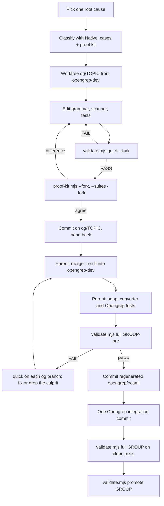

# How we work on the grammar

How fixes to the PowerShell grammar are made, checked and integrated into
Opengrep. Background: [ARCHITECTURE.md](ARCHITECTURE.md). Setup and commands:
[README.md](README.md).

Placeholders: `$OPENGREP` is the Opengrep checkout; `$GRAMMAR` is this
repository as its submodule
(`$OPENGREP/languages/powershell/tree-sitter/opengrep-powershell`), on branch
`opengrep-dev`; `$W` is a fix worktree.

## Policy: Opengrep only

- Only Opengrep and the grammar it uses matter: the simplified ABI 14 parser on
  the tree-sitter 0.22.6 runtime. Every gate tests that parser.
- Fixes branch from `opengrep-dev` as `og/TOPIC`. We do not make Airbus-based
  branches or standalone Airbus proofs; the old `fix/...` branches are history.
- Fix branches do not regenerate the root `src/parser.c` (tree-sitter 0.25).
  Opengrep does not use it, and leaving it alone avoids merge conflicts.
- PowerShell fixes go in the root `grammar.js`, `src/scanner.c` and
  `src/parameter_letters.h`. Rule-only syntax goes in `opengrep/grammar.cjs`.
- Correct PowerShell support in Opengrep takes priority over preserving an
  upstream grammar bug or its expected test output.

### Correcting an existing test expectation

This applies to all tests, including those inherited from Airbus. A failing
test after a grammar change can mean a regression or a previously incorrect
expectation; do not assume either without evidence.

1. Establish the intended behaviour with Native PowerShell and the proof kit.
   Check the relevant validity, kinds, extents and values. A CST need not have
   the same shape as Native's AST: show the actual syntax or semantic problem
   and its effect on Opengrep.
2. Prove the grammar correction with synthetic variations, neighbouring forms
   and negative controls. Run quick validation and the proof suites; unrelated
   regressions must be fixed, not approved.
3. If that evidence establishes that the existing expectation is wrong,
   correct it in the same fix commit. Keep the original test input and
   coverage, review every changed expected tree, and record the Native
   evidence and rationale in the proof suite and commit message.
4. The parent reviews the correction during integration. Do not stop merely
   because the expectation came from upstream. If the evidence is inconclusive,
   investigate or report that uncertainty instead of changing expectations.

The source gate preserves inherited test inputs, names and flags, not their
expected trees. It does not verify the justification for an expectation change;
Native proofs and review do that. Never remove or skip cases, weaken
comparators, add unexplained known differences, or bulk-approve failures.

## Fix lifecycle

### Fix agent (one root cause)

The full brief is [skills/fix-agent/SKILL.md](skills/fix-agent/SKILL.md). In short:

The parent assigns independent grammar root causes to fix agents rather than
implementing additional grammar topics itself. Parent work is classification,
coordination, merging, converter integration and certification. Finishing a
cancelled worker's preserved task is the exception.

1. **Classify with PowerShell's parser first.** Write made-up cases
   (reductions, negative controls, neighbouring forms that already work) and run
   the proof kit on the current parser to see the failure.
2. **Create the worktree:**
   `git -C "$GRAMMAR" worktree add -b og/TOPIC "$W" opengrep-dev`.
   `$GRAMMAR/ai-docs/local/worktrees/og-TOPIC` is a good place for `$W`: it is
   ignored by Git and by Opengrep's Dune build.
3. **Edit** the grammar, scanner or pattern syntax, and append tests.
4. **Prove the target first:** run the topic's cases with `--fork "$W"` before
   paying for quick's whole-corpus checks.
5. **Validate quick**, then run `--suites --fork "$W"` once the topic is ready
   to hand back. It uses the worktree's committed cases plus canonical local
   cases. New differences remain regressions; do not rerun every suite after
   every small edit.
6. **Commit on `og/TOPIC`** and hand back the branch with a short report.

Always run the tools from `$GRAMMAR` (its `ai-docs/local/` has the config,
vendor files, corpus and baseline), and point them at `$W` with `--fork`.

### Parent (integrating a group)

1. Merge each `og/TOPIC` into `opengrep-dev` in `$GRAMMAR` with `--no-ff`,
   serially. Resolve `grammar.js`, scanner and test conflicts by hand. Generated
   files should not conflict because fix branches do not regenerate them; never
   hand-merge generated tables. Lists of external tokens in `grammar.js` and
   `src/scanner.c` must keep the same order.
2. Adapt the converter and its tests in Opengrep as needed (new or renamed CST
   types).
3. Run `node ai-docs/tools/validate.mjs full --label GROUP-pre`. It regenerates
   `opengrep/ocaml/` and reports drift against HEAD, which is expected here.
   - If it fails, run `validate.mjs quick` on each preserved `og/*` branch to
     find the culprit.
   - Run `node ai-docs/tools/proof-kit.mjs --suites` (default parser: the
     integrated one).
4. Commit the regenerated `opengrep/ocaml/` on `opengrep-dev`, with the fix
   table in [opengrep/README.md](../opengrep/README.md): one regeneration commit
   per group.
5. Make **one Opengrep integration commit per group**: converter, tests, docs
   and the submodule pin, so that it builds and passes on its own. A fix that
   needs real converter work (a new representation, not just renamed types)
   gets its own cycle and commit.
6. Run `validate.mjs full --label GROUP` on the clean, committed trees, then
   `validate.mjs promote GROUP`.
7. Update Opengrep's `languages/powershell/README.md` if user-visible coverage
   changed.

## Roles

| Fix agent | Parent |
| --- | --- |
| One root cause in its own `og/TOPIC` worktree. | Assigns independent grammar topics to fix agents, fills in each TOPIC block, and coordinates parallel work. |
| Edits only `grammar.js`, `src/scanner.c`, `src/parameter_letters.h`, `opengrep/grammar.cjs` (pattern syntax), tests and its own cases. | Merges serially and resolves conflicts by hand. |
| Runs only `validate.mjs quick` and `proof-kit.mjs`: no Dune, no `full`, no sub-agents. | Owns regeneration, converter changes, Dune, `validate.mjs full`, commits on both repositories, and promotion. |
| Writes only in its worktree and in run or report folders the tools create. | Verifies agent claims independently before relying on them. |
| Reports branch, commit, proof summaries before and after, the quick summary and the expected converter impact. | Updates docs and the fix table. |

No nested agents and no messages between fix agents. If a fix agent is
cancelled, the parent inspects its Git state and finishes the work itself rather
than starting a duplicate.

## Rules

- **Test the parser Opengrep runs.** Every gate uses ABI 14 on 0.22.6.
- **The corpus is read-only data**, and PowerShell only parses (see
  [README.md](README.md#safety-rules)). Committed cases are made-up reductions.
- **Never hide a failure.** Do not relax a comparator or exclusion to make a
  run pass, or use `--update`, `test approve` or `dune promote` to hide failures.
  Proven-wrong expectations are corrected under the policy above, not treated
  as immutable.
- **Preserve test inputs and coverage.** Add cases for new behaviour; invalid
  controls must really fail. Correct inherited expectations when Native
  evidence proves the change is right.
- **Known differences are explicit**, each with a reason, and reported separately.
- **Categories stay distinct.** Encoding reviews, grammar errors, unsupported
  conversion, timeouts and exceptions are never merged, and rates are never
  improved by excluding files.
- **Original bytes.** Findings and captures are checked against the original
  file bytes, and finding sets are compared, not only counts. Parse success
  alone does not prove a correct parse.
- **No shared Opengrep code changes without discussion.** PowerShell logic stays
  in its frontend. Encoding work is deferred.
- **Local only.** No pushes, upstream issues or pull requests without
  permission. No `make clean`, `git clean`, destructive resets or
  `git submodule update`. Do not delete preserved branches or worktrees as
  routine cleanup.
- **Scratch goes in `ai-docs/local/`.** The tools give each build its own
  `TREE_SITTER_LIBDIR`; do the same for manual `tree-sitter test` runs, since the
  CLI caches compiled parsers by language name. Also give each invocation its
  own `XDG_CACHE_HOME`; the CLI's compilation lock otherwise remains shared.
- **Bound console output, not proof coverage.** The kit keeps full JSON and
  caps console output at 6 KB by default. Use `--all` only for small selected
  cases; inspect particular JSON entries and generated-type hunks, not whole reports.
- **Blockers are recorded** with their evidence; then continue with independent
  work.

## Commit conventions

- Stage files by name. No `git add -A`, `git add .` or other broad staging.
- Descriptive messages: what PowerShell accepts, what the grammar or converter
  did, and the validation evidence.
- No co-author trailers.
- Grammar repository: one commit per fix on `og/TOPIC`; a `--no-ff` merge into
  `opengrep-dev`; one regeneration commit for `opengrep/ocaml/` per group.
- Opengrep: one integration commit per group (converter, tests, docs, pin).
- Promote only after a full run on the clean, committed trees.

## Suite expectations

`ai-docs/cases/SUITE.expected.json` records each suite's current result
([cases/README.md](cases/README.md)). Update expectations only deliberately:

- when a reviewed grammar change improves a suite (the kit reports
  `IMPROVED`), or
- when adding a suite or a case.

Run `node ai-docs/tools/proof-kit.mjs --suites --suite NAME --write-expectations`
for the suites that should change (add `--fork "$W"` and the worktree's
`ai-docs/cases` folder for a fix branch; without `--suite` every suite is rewritten),
review every changed line with `git diff`, and commit the expectations with the
change that caused them. Never write expectations to make a failing suite pass:
a new difference or a worse status is a regression to fix.
